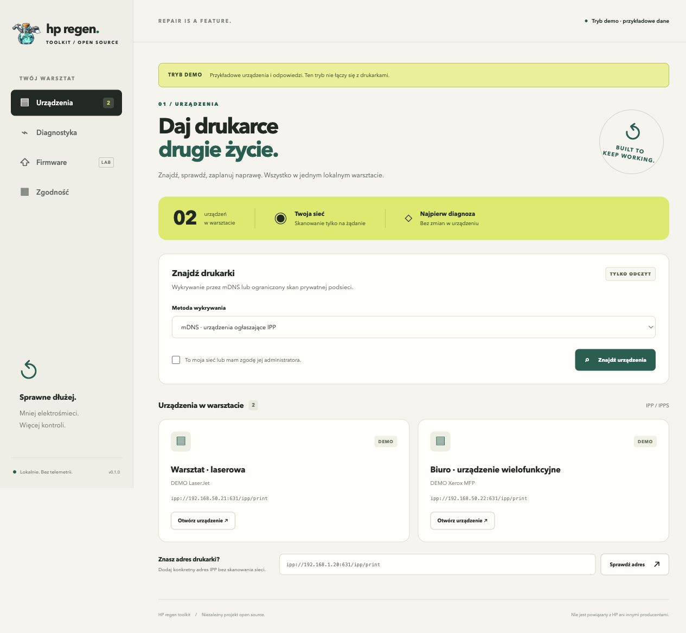

# HP regen toolkit

<p align="center"></p>

**Lokalny, otwarty warsztat dla drukarek, które zasługują na drugie życie.** Jeden panel do odnajdywania urządzeń, odczytu możliwości i usterek, przywracania drukowania przez CUPS oraz przygotowania naprawy firmware konkretnego modelu.

Niezależny projekt społecznościowy, bez powiązania z HP, Xerox ani innymi producentami. Nazwa robocza „HP regen toolkit” nie ogranicza projektu do jednej marki. Licencja MIT umożliwia również komercyjne usługi i rozwój.



## Co działa w v0.1

- Wykrywanie IPv4 mDNS usług IPP/IPPS i jawny odczyt wskazanej prywatnej podsieci (maks. 256 adresów).
- Rzeczywisty odczyt IPP `Get-Printer-Attributes`: model, stan, zgłoszone powody błędów, formaty druku i informacje firmware, gdy urządzenie je udostępnia.
- Ręczne wskazanie URI IPP, gdy multicast/Wi-Fi discovery nie działa.
- Plan konfiguracji i utworzenie lokalnej kolejki CUPS driverless po potwierdzeniu, bez nadpisywania istniejących kolejek i bez `sudo`.
- Lokalny raport JSON, panel po polsku, CLI, jawnie oznaczony tryb demonstracyjny.
- Offline preflight firmware: SHA-256, rozmiar i dokładna nazwa modelu. **To nie potwierdza autentyczności ani zgodności sprzętowej.**

## Co jest jeszcze do zrobienia

Nie ma certyfikowanych adapterów jailbreaku, downgrade'u, flashowania, odzyskiwania bootloadera ani wymiany płyty sterującej. Nie ma też jeszcze własnego spoolera, obsługi USB, SNMP, IPv6, kolejek Windows ani instalatora aplikacji desktopowej. Kod sieciowy jest przetestowany na pakietach i symulatorze; brak testu fizycznej drukarki. Panel/CLI to wczesny prototyp, nie gotowy uniwersalny serwis naprawczy.

Otwartość aplikacji nie zmienia licencji ani ograniczeń oryginalnego firmware. Nie dołączamy obrazów producentów. Brak wyniku wykrywania nie oznacza, że urządzenia nie da się uratować.

## Uruchomienie

Python 3.11 lub nowszy. Aplikacja nie ma zależności wykonawczych.

```sh
git clone https://github.com/maciejpatej/hp-regen-toolkit.git
cd hp-regen-toolkit
python3 -m venv .venv
# macOS / Linux:
. .venv/bin/activate
# Windows PowerShell: .venv\Scripts\Activate.ps1
python -m pip install .
hp-regen serve --demo
```

Panel: **http://127.0.0.1:8765**. Tryb demo nie odpytuje drukarek ani nie zmienia kolejek. Aby użyć rzeczywistych urządzeń: `hp-regen serve`. Start w trybie live również nie skanuje sieci; każda operacja wymaga polecenia użytkownika. CUPS potrzebny jest tylko do integracji kolejek na macOS/Linux.

Bez instalacji, macOS/Linux: `PYTHONPATH=src python3 -m hp_regen serve --demo`. Windows PowerShell: `$env:PYTHONPATH='src'; python -m hp_regen serve --demo`.

```sh
hp-regen discover --acknowledged
hp-regen discover --cidr 192.168.1.0/24 --acknowledged
hp-regen inspect ipp://192.168.1.25:631/ipp/print --acknowledged
hp-regen queues
hp-regen bridge ipp://192.168.1.25:631/ipp/print --name Regen_Printer
# Wykonanie planu: ponownie bridge z --apply --acknowledged.
```

URI przyjmuje tylko `ipp://` i `ipps://`, dosłowny prywatny adres IPv4 albo `127.0.0.1`, port 631 lub 443. Nazwy DNS i inne porty nie są obsługiwane w tej wersji. IPPS weryfikuje certyfikat; adres IP może nie odpowiadać nazwie certyfikatu urządzenia — nie wyłączamy weryfikacji TLS. mDNS wymaga tej samej domeny multicast; VLAN, izolacja klientów Wi-Fi i firewalle mogą blokować discovery. Skan podsieci sprawdza ścieżkę `/ipp/print`; inne ścieżki podaj ręcznie.

## Firmware bez udawanej pewności

```json
{
  "schema_version": 1,
  "model": "DOKŁADNY MODEL Z ETYKIETY",
  "firmware_version": "WERSJA OBRAZU",
  "sha256": "64_ZNAKI_SHA256_Z_ZAUFANEGO_ZRODLA",
  "size": 12345,
  "source_url": "https://example.org/legal-source-of-image"
}
```

Powyższy szablon wymaga uzupełnienia poprawnego hash i rozmiaru. Limit obrazu v0.1: 4 MiB; większe firmware wymagają późniejszego adaptera strumieniowego.

```sh
hp-regen preflight --manifest manifest.json --file obraz.bin --model 'DOKŁADNY MODEL Z ETYKIETY'
```

Nawet komplet zgodnych pól daje `ready_to_flash: false`. Manifest jest danymi wejściowymi, nie zaufanym podpisem. [Kontrakt adapterów](docs/MODEL_ADAPTERS.md) określa bramkę dla przyszłego rzeczywistego zapisu.

## Kierunek projektu

[Konkurenci i komponenty](docs/COMPETITORS.md) · [Wymiana elektroniki i model biznesowy](docs/HARDWARE_ROADMAP.md) · [Roadmapa](docs/ROADMAP.md) · [Bezpieczeństwo](SECURITY.md) · [Testy i ograniczenia](docs/VALIDATION.md).

Pierwszy pilot: **HP LaserJet Pro P1102w**, host Linux/CUPS, początkowo USB. [Profil i warunki testu](docs/PILOT_P1102W.md). Status: kandydat, bez fizycznej walidacji; HPLIP ma zależność od zamkniętej wtyczki, foo2zjs-z2 wymaga osobnego testu.

Pierwszy krok do napraw firmware: konkretne urządzenie z etykietą modelu/SKU, rewizją płyty, aktualną wersją firmware i opisem usterki. Most Raspberry Pi/CUPS może rozwiązać brak sterowników lub słabe Wi-Fi z zachowaniem oryginalnej elektroniki; własny kontroler wymaga osobnego projektu sprzętowego i testów.
